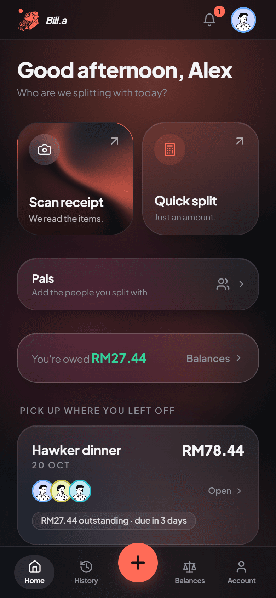
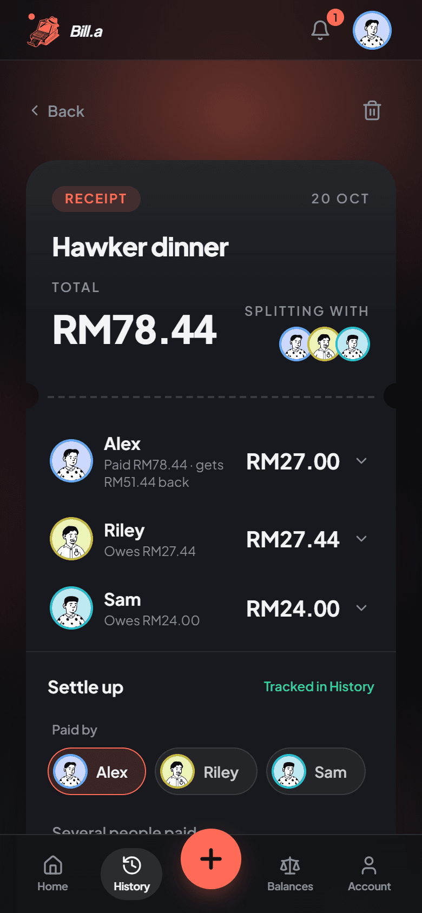
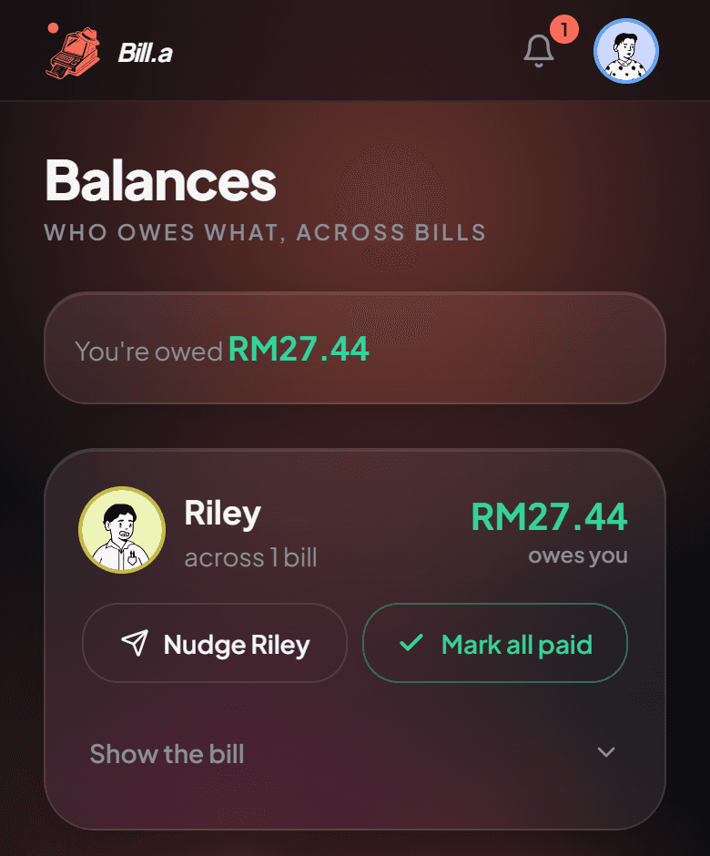
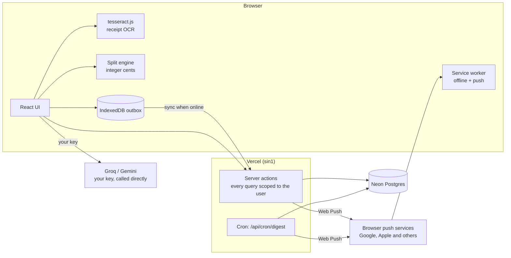
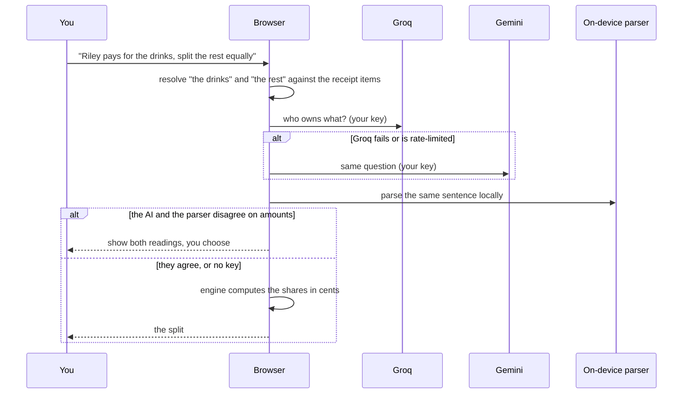
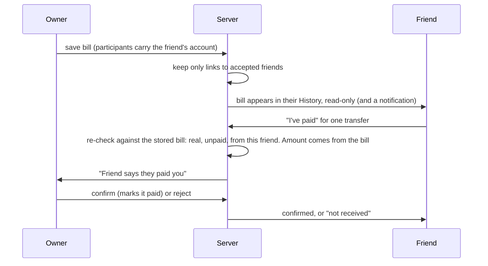

<p align="center">
  <a href="https://bill-a.vercel.app/">
    
    
    
  </a>
</p>

<h1 align="center">Bill.a</h1>

**Split a bill exactly, down to the cent, then keep track of who has paid you back. Scan a receipt or say who owes what in plain words, with DuitNow and WhatsApp built in.**

<p align="center">
  <a href="https://bill-a.vercel.app/"><strong>bill-a.vercel.app</strong></a>
</p>

| | |
| --- | --- |
| **Live app** | [bill-a.vercel.app](https://bill-a.vercel.app/) (installable as a phone app) |
| **App** | Next.js 16 (App Router), React 19, TypeScript, Tailwind CSS 4 |
| **Data** | Neon Postgres over HTTP with Drizzle, Auth.js v5 |
| **AI** | None on the server: you bring your own free Groq or Gemini key, and the browser calls the provider directly |
| **OCR** | tesseract.js (WebAssembly) in your browser, nothing is uploaded |

---

## Contents

- [Features](#features)
- [How it works](#how-it-works)
  - [Architecture](#architecture)
  - [Splitting, and why the money is exact](#splitting-and-why-the-money-is-exact)
  - [Plain-English splits and the AI cascade](#plain-english-splits-and-the-ai-cascade)
  - [Saving offline](#saving-offline)
  - [Pals, shared bills and payment claims](#pals-shared-bills-and-payment-claims)
  - [Notifications](#notifications)
- [Tech stack](#tech-stack)
- [Getting started](#getting-started)
  - [Requirements](#requirements)
  - [Run it](#run-it)
  - [Environment variables](#environment-variables)
  - [Tests and checks](#tests-and-checks)
  - [Debugging](#debugging)
- [Deployment](#deployment)
- [Project structure](#project-structure)
- [Security and privacy](#security-and-privacy)
- [Limitations](#limitations)
- [Planned](#planned)
- [Support and credits](#support-and-credits)
- [License](#license)

---

## Features

| Area | What it does |
| --- | --- |
| **Scan on your device** | A photo of the receipt is read by [tesseract.js](https://github.com/naptha/tesseract.js) in a Web Worker. A deterministic parser turns the text into items, tax and a total in integer cents. After one online visit, scanning works with no signal. |
| **Split in plain words** | "Riley pays for the drinks, split the rest equally." A reference resolver works out what "the drinks" and "the rest" mean, and the model only decides who owns what, never the arithmetic. |
| **Other ways to split** | Equal, custom shares, percentages, ratios and fixed amounts, with a slider per person. **Quick split** divides an amount without a receipt. |
| **Exact to the cent** | Every share is computed once, in integer cents, so a bill always adds up to the printed total. Cash rounding (nearest 5 cents or whole unit) puts the difference on one chosen person. |
| **Settle up** | Say who paid (one person or several), get the fewest transfers between people, mark each one paid, and set a due date. |
| **Balances** | What each person owes you, or you owe them, across all your bills, with one nudge and one **Mark all paid** per person. |
| **Pay-me details** | Save your DuitNow QR or ID, bank account and a note. They appear on receipts and in messages. |
| **Share the receipt** | Send a summary as text, or as a picture of the receipt (with your payment QR) through the phone's share sheet. |
| **Nudges** | Remind someone on WhatsApp. With a saved number it opens their chat directly, otherwise the share sheet. |
| **Pals and friends** | Keep a list of the people you split with, with optional WhatsApp numbers. Link a Bill.a friend by their exact `@username`, an invite link or a QR code. |
| **Shared bills** | A bill that includes a linked friend appears in their History, read-only. They can tap **I've paid**, and you confirm or reject it. You can see who a bill is shared with and unshare it. |
| **Notifications** | An inbox you can swipe to clear, phone push notifications (Web Push), and one short daily summary. You choose which kinds reach your phone. |
| **Groups and accounts** | Save named groups. Sign in with Google or email and password. History, groups and pals are scoped to your account. |
| **Bring your own AI key** | Add a free Groq and/or Gemini key in the app. It stays in your browser. Without one, an on-device parser still handles clear instructions. |
| **Catches a wrong AI answer** | When the AI's plan and the on-device parser disagree on the amounts, both readings are shown and you choose. |
| **Works like an app** | Installable, works offline for splitting and scanning, local-first saves that sync when you are back online. Dark theme only. |

## How it works

### Architecture



| Piece | Runs in | Job |
| --- | --- | --- |
| `lib/ocr/` | Browser (Web Worker) | Preprocess the photo, run OCR, parse lines into items, tax and total. |
| `lib/split/` | Browser and server | The arithmetic engine, the on-device instruction parser, settle-up maths. |
| `lib/ai/` | Browser | Intent routing, prompts, schema validation and the provider cascade. |
| `lib/actions/` | Server | Server actions: the only way the client reads or writes the database. |
| `lib/db/` | Server | The Drizzle schema and every query, each scoped to the signed-in user. |
| `scripts/sw.template.js` | Browser | The service worker source. `npm run sw:build` writes `public/sw.js` from it. |
| `app/api/cron/digest` | Server | Builds the once-a-day summary. Refuses any request without `CRON_SECRET`. |

### Splitting, and why the money is exact

All money is whole cents. [`lib/split/engine.ts`](lib/split/engine.ts) is the only place a share is computed: each person's part of each item is an exact fraction of cents, rounded once at the end. The shares are then adjusted so they add up to the bill total, and a split that cannot reconcile is rejected rather than shown. Naive per-item rounding drifts by a cent or two on a long receipt, which is the bug this avoids. Settle-up (`lib/split/settle.ts`) then works out the fewest transfers from who paid and who owes.

### Plain-English splits and the AI cascade



The model only ever answers "who owns what". The engine does the maths, and every model response is validated with zod before it is used. Which models are current is kept in [`lib/ai/providers/models.ts`](lib/ai/providers/models.ts), the only place the ids live, because providers retire models every few months. Keys are read from `localStorage` and sent only to the provider's own domain, which the Content-Security-Policy enforces.

### Saving offline

A save is written to an IndexedDB outbox first and returns immediately, then a sync manager drains it to the server whenever there is a connection. Each bill has a client-generated id that is unique per user, so retrying never duplicates a row. The service worker keeps the OCR runtime and the guest-usable app shell, and never caches per-user pages or any non-GET request, so one person's data cannot be served to another on a shared phone. The saved pals list is cleared on sign-out.

### Pals, shared bills and payment claims

A pal is a name with an optional WhatsApp number. A pal becomes a **friend** when you and another account accept each other, found by exact `@username` (no browsing or partial search), an invite link or a QR code. When a bill includes a linked friend, the bill records their account, not just their name, and the server keeps that link only for accepted friends.



Friends see the whole bill (names and amounts) but never another person's account details, and your payment details are shown only on a bill where they owe you. Unfriending ends every share between the two at once. If a friend changes their name, the bills, contacts and groups that name them follow.

### Notifications

Every event (friend request, bill shared, payment claim, nudge, the daily summary and a welcome note) is written to the user's inbox first. If push is configured and the person has not muted that kind, the same sentence is sent to their devices after the response, so it never slows the action that caused it. A device the push service reports gone is removed. The daily summary is built by `/api/cron/digest` once a day for each user's own date and is deduplicated, so a retry sends nothing twice. Tapping a notification opens the page it is about and marks it read; a push that arrives while the app is open and in front becomes a toast instead of a system notification.

## Tech stack

| Layer | Choice | Why |
| --- | --- | --- |
| Framework | Next.js 16 (App Router), React 19 | Server actions give a typed, session-scoped data layer with no separate API service. |
| Styling | Tailwind CSS 4, shadcn/ui, Motion | Design tokens in one place; glass panels over a slow gradient backdrop. |
| Auth | Auth.js v5, JWT sessions, argon2id | No session table to query on every request; Google and email sign-in. |
| Data | Neon Postgres, Drizzle ORM (HTTP driver) | Serverless-friendly, and the schema and migrations are plain SQL. |
| OCR | tesseract.js 7, self-hosted | Photos never leave the device, and it works offline. |
| AI | Groq `openai/gpt-oss-20b`, Gemini `gemini-3.5-flash-lite` (your key) | The server holds no AI key, so it has no AI bill and no key to leak. |
| Offline | Hand-written service worker, `idb` | Control over exactly what is cached and what never is. |
| Push | `web-push` (VAPID), service worker | Standard Web Push, no third-party notification service. |
| Receipt image | modern-screenshot | The picture is the same HTML you preview, so what you see is what is sent. |
| Tests | Vitest | Fast unit tests plus real-database tests on a separate Neon branch. |

## Getting started

### Requirements

- Node.js 20.9 or newer (required by Next.js 16)
- A [Neon](https://neon.tech) Postgres project
- A Google OAuth client for Google sign-in (optional: email and password work without it)

### Run it

```bash
git clone https://github.com/PravinRaj01/Bill-a.git
cd Bill-a
npm install
cp .env.example .env.local      # then fill it in, see the table below
npx drizzle-kit migrate         # applies drizzle/ using DATABASE_URL_UNPOOLED
npm run dev
```

`npm run dev` first copies the OCR assets and builds the service worker (`predev`). The app needs no AI key: without one, instructions fall back to the on-device parser. To try the AI path, add a Groq or Gemini key from Account › AI.

### Environment variables

Names only; never commit values (`.env*` is gitignored except `.env.example`).

| Name | Required | Purpose |
| --- | --- | --- |
| `DATABASE_URL` | Yes | Neon **pooled** connection string, used at runtime. |
| `DATABASE_URL_UNPOOLED` | For migrations | Neon **direct** connection string, used by `drizzle-kit`. Not needed on Vercel. |
| `AUTH_SECRET` | Yes | Signs the session cookie. |
| `AUTH_GOOGLE_ID`, `AUTH_GOOGLE_SECRET` | For Google sign-in | Google OAuth client. |
| `NEXT_PUBLIC_VAPID_PUBLIC_KEY`, `VAPID_PRIVATE_KEY` | For push | Web Push keys from `npx web-push generate-vapid-keys`. Changing them drops every device's subscription. |
| `VAPID_SUBJECT` | For push | A `mailto:` or `https:` contact for the push services. |
| `CRON_SECRET` | For the daily summary | Vercel Cron sends it as a bearer token to `/api/cron/digest`. |
| `ENABLE_DEV_PAGES` | No | Set to `1` to expose `/dev/*` in a production build. |
| `GROQ_API_KEY`, `GEMINI_API_KEY` | No | Used only by `npm run live:check`, never by the app. |

Without the VAPID keys nothing is pushed and the inbox still works.

### Tests and checks

```bash
npm test                         # 865 tests in 63 files, as of this README
npx tsc --noEmit                 # types
npx eslint .                     # lint
npm run live:check               # real Groq/Gemini calls using keys from .env.local
npm run live:check -- --bakeoff  # score each model on the accuracy cases
npm run bench:ocr                # OCR accuracy and speed on bench/receipts/
```

The database tests (`lib/db/*.test.ts`, 11 files) write real rows, so they read **`.env.test.local` only**, never `.env.local`, and skip themselves when that file is missing. Create a schema-only Neon branch for it. They include cross-user tests: one user can never read or change another's rows.

### Debugging

- `/dev/ui-kit` shows every UI primitive, and `/dev/model-bakeoff` compares models. Both return a 404 in production unless `ENABLE_DEV_PAGES=1`.
- The service worker only runs in a production build. To test push or offline, run `npm run build` then `npm start`.
- Telemetry is written to the server log as `{"telemetry": ...}` lines and contains no names, amounts or keys.

## Deployment

Bill.a runs as one Vercel project in the Singapore region (`sin1`, next to the database) with a Neon Postgres database. `vercel.json` pins the region and schedules `/api/cron/digest` once a day at 01:00 UTC (09:00 in Malaysia), which fits the Hobby plan. The order is: create a production Neon branch and run the migrations against it, add the Google redirect URI, import the repo into Vercel, set the environment variables, deploy, then run the smoke-test list. The full walkthrough, with that checklist, is in [`docs/DEPLOYMENT.md`](docs/DEPLOYMENT.md).

New migrations are additive so they can be applied before the code that needs them is deployed.

## Project structure

```
Bill-a/
├── app/
│   ├── page.tsx               sign in and sign up
│   ├── dashboard/             the app: new, history, balances, people, notifications, account, groups, shared, add
│   ├── api/auth/              Auth.js route handler
│   ├── api/cron/digest/       the daily summary (needs CRON_SECRET)
│   ├── api/telemetry/         allowlisted, privacy-preserving event log
│   └── dev/                   UI kit and model bake-off (404 in production)
├── components/                UI by area (split, receipt, balances, people, notifications, account, ...)
│   └── ui/                    shadcn/ui primitives and the Graphite Glass tokens in use
├── hooks/                     the split session, settle-up, phone book and payment hooks
├── lib/
│   ├── ai/                    intent routing, prompts, schemas, validation, provider cascade
│   ├── split/                 the exact-cent engine, on-device parser, settle-up, participants
│   ├── ocr/                   preprocessing, tesseract.js adapter, line parsing
│   ├── retrieval/             "the drinks" / "the rest" reference resolution
│   ├── actions/               server actions, the only way the client touches the database
│   ├── db/                    Drizzle schema, queries, social (friends, shares, claims), notifications, digest
│   ├── notifications/         notification text, categories and the daily summary
│   ├── push/                  Web Push sending and the client helpers
│   ├── payment/               DuitNow QR and ID, bank details, formatting
│   ├── people/                phone numbers, rename sync, the offline pals cache
│   ├── sync/                  the IndexedDB outbox
│   ├── auth/                  password hashing, session helpers
│   ├── validation/            zod schemas for bills, payments, people, profile
│   ├── ui/                    avatars, sharing, the receipt image
│   └── telemetry/             the allowlisted event schema and client
├── drizzle/                   SQL migrations 0000 to 0011
├── scripts/                   service worker template and build, OCR asset copy, data backfill
├── bench/                     OCR and model benchmarks (see bench/receipts/README.md)
├── docs/                      deployment guide and README images
├── public/                    icons, manifest, the generated service worker, OCR runtime
├── middleware.ts              Auth.js route protection
└── legacy/python-backend/     archived FastAPI service, not built or deployed
```

## Security and privacy

**What is stored.** Your account (name, email, a password hash or Google link, optional `@username`, portrait choice, time zone and notification choices), your saved bills, groups and pals, friendships, shares and payment claims, your inbox, and one row per phone you turned push on for. Payment details are stored on your account, only for you to share.

**What never leaves your device.** Receipt photos (OCR runs in the browser unless you tap *Re-read with Gemini*, which sends that one photo to Google with your own key) and your AI keys, which live in `localStorage` and go only to the provider you chose. The server has no AI key at all.

**How data is protected.**
- Every database query is scoped to the signed-in user on the server. There is no client-trusted user id anywhere in the query path, and cross-user tests cover each new query.
- A friend can reach a bill only through an explicit share row and a separate read-only query that never returns the owner's client id. Payment claims are re-checked against the stored bill, and the amount always comes from the bill.
- Friend search is exact `@username` only, answers "not found" the same way for any miss, and never returns ids or emails of strangers.
- The Content-Security-Policy limits browser calls to your own origin and the two AI providers.
- Telemetry is an explicit allowlist (categorical facts only, such as which AI tier answered) and error text is redacted.
- Signing out removes this phone's push subscription and clears the cached pals list.

If you use Google's free Gemini tier, Google may use prompts to improve its products; the app says so next to the key field.

## Limitations

- **Currencies are symbols** (such as "RM"), not ISO codes. Balances and the daily summary never add across currencies.
- **Edits from two devices are last-write-wins.** The `updated_at` column is groundwork for real conflict handling.
- **Username search has no shared rate limiter.** It relies on exact match, a generic "not found" and a cap of 50 pending requests. A proper limit needs a shared store such as Upstash.
- **No email verification, password reset or login rate limiting** yet.
- **iPhone push** works only after the app is added to the Home Screen, and the inbox is the source of truth if delivery is late. Some Android phones delay background pushes until battery settings allow them.
- **The daily summary runs once a day** at 01:00 UTC, not at 9am in each person's own zone.
- **The service worker only runs in production builds**, so offline and push cannot be tried in `npm run dev`.
- `middleware.ts` still uses the pre-Next 16 file name (a deprecation warning, still works).

## Planned

Ideas that are agreed but not built, each with a GitHub issue.

- **Daily summary at 9am in each user's own time zone** ([#72](https://github.com/PravinRaj01/Bill-a/issues/72)). Drop the Vercel cron and have a free scheduler such as cron-job.org call `/api/cron/digest` hourly with `Authorization: Bearer <CRON_SECRET>`, sending to each user at 9am their time.
- **Choose your portrait colour, orange by default** ([#73](https://github.com/PravinRaj01/Bill-a/issues/73)). Today a portrait's colour comes from the name, so it changes with how the name is written. The choice would be stored on the account and shown wherever the app knows it is that user.

## Support and credits

Report a bug or an idea in the [GitHub issues](https://github.com/PravinRaj01/Bill-a/issues). For a problem with a receipt, say what it was (a photo helps) and what the scan read.

Built on [tesseract.js](https://github.com/naptha/tesseract.js) for OCR, [DiceBear](https://www.dicebear.com/) (Notionists style) for portraits, [Auth.js](https://authjs.dev/), [Drizzle](https://orm.drizzle.team/), [shadcn/ui](https://ui.shadcn.com/) and [Neon](https://neon.tech). The OCR benchmark receipts are described in [`bench/receipts/README.md`](bench/receipts/README.md).

## License

There is no `LICENSE` file yet, so all rights are reserved by default until one is added.

---
Built by PravinRaj
